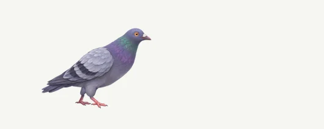

# The pigeon is really funny

[English](README.md) · [简体中文](README.zh-CN.md)

A pigeon for your Windows desktop. Watch its head stay still for a beat as its body catches up, then dart forward on the next step. It wanders, slows down to inspect things, looks around and pecks at the ground.



**[Download the Windows x64 pigeon](https://github.com/Yafeiml/the-pigeon-is-really-funny/releases/latest/download/Pigeon-Windows-x64.exe)** · [Release notes](https://github.com/Yafeiml/the-pigeon-is-really-funny/releases)

## Meet your pigeon

Save `Pigeon-Windows-x64.exe` in a folder you can write to and double-click it on Windows 10 or 11 (x64). The single file contains all six animation clips. The pigeon and a tray icon appear on your desktop.

- Drag the bird to move it. Right-click its body or the tray icon to open the menu. Under **Language**, choose **Follow Windows**, **English** or **简体中文**. The choice applies immediately and is saved. With **Follow Windows**, Chinese display languages use Simplified Chinese and all other languages use English.
- Choose **Free roam** to explore or **Rest in place** to look around and peck. Set size from 50–100% or choose 1×, 1.5× or 2× speed.
- Drag the pigeon right up to the screen edges. While roaming it walks across adjacent displays where their edges meet at its height. At the outer edge, the part that crosses the edge immediately appears on the opposite side.
- Turn on **Launch at sign-in** to start the pigeon when you sign in to Windows. It is off by default. If you move or rename the EXE, enable it again from the new location. Opening the EXE again leaves the existing pigeon running.
- Set a 60, 120 or 144 FPS cap. The display refresh rate limits the effective frame rate. Full-screen hiding and click-through are available from the same menu.
- Your preferences are saved in `%LOCALAPPDATA%\DesktopPigeon\settings.ini`. If you used the folder-based prototype, exit it from the tray before launching this release. Your preferences carry over.

## Updates

The pigeon checks this repository's latest stable GitHub Release in the background once a day. Choose **Check for updates** in the tray to check now. It downloads a newer EXE, verifies its SHA-256, version and embedded animation, then replaces the file. The new version takes effect on your next launch. If GitHub is unreachable, the current pigeon keeps running.

## Build from source

On Windows x64, install a current stable Rust toolchain with MSVC and the Windows SDK, or MinGW with windres. You also need Python with Pillow and NumPy to generate the animation. From the repository root, run these commands in PowerShell 7.

```powershell
python -m venv .venv
.\.venv\Scripts\python -m pip install Pillow numpy
.\.venv\Scripts\python tools/animate_2d.py
cargo test --locked --features standalone
pwsh -File .\build-release.ps1
```

The generator builds 2,508 frames from the two source paintings. The packaging script verifies every embedded frame before writing `release/Pigeon-Windows-x64.exe`. At runtime, the bird maps up to 8 MiB of compressed frames at a time and reuses a pixel buffer. You can move the finished EXE to another folder and run it there.

For a new release, bump the version in `Cargo.toml` and refresh `Cargo.lock`, rebuild, and create a GitHub Release tagged `vX.Y.Z` matching the binary version. Attach the file under its exact name `Pigeon-Windows-x64.exe` and publish it as the latest stable release.

## License and artwork

The project uses the [MIT License](LICENSE). See the [artwork notes](ARTWORK.md) for the two source paintings and their animation rig. Dependency licenses are included in the [third-party notices](THIRD-PARTY-NOTICES.txt).
