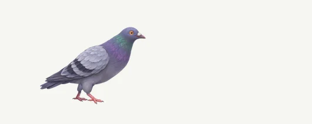

# The pigeon is really funny

[English](README.md) · [简体中文](README.zh-CN.md)

一只住在 Windows 桌面上的鸽子。它走路时脑袋会在原地稳住一瞬，等身子追上来，再猛地往前一探。走着走着，它也会放慢脚步，东张西望，偶尔低头啄两下。



**[下载 Windows x64 单文件版](https://github.com/Yafeiml/the-pigeon-is-really-funny/releases/latest/download/Pigeon-Windows-x64.exe)** · [更新记录](https://github.com/Yafeiml/the-pigeon-is-really-funny/releases)

## 让鸽子上桌面

把 `Pigeon-Windows-x64.exe` 保存到自己有写入权限的文件夹，在 Windows 10 或 11（x64）上双击运行。六段动画都装在这个文件里。启动后，桌面会出现鸽子，托盘里会出现它的图标。

- 拖动鸽子可调整位置。右击鸽子本体或托盘图标，打开**语言**可选择**跟随 Windows**、**English** 或**简体中文**，切换后立即生效并记住选择。跟随 Windows 时，中文显示语言使用简体中文，其他显示语言使用英文。
- 勾选**开机自启**后，每次登录当前 Windows 账户都会启动鸽子。此项默认关闭。如果移动或重命名了 EXE，请在新位置重新勾选。重复双击 EXE 会保留桌面上已有的那只鸽子。
- **自由活动**时鸽子会四处游走，**原地休整**时会停下来张望和啄地。大小可从 50% 调到 100%，速度可选 1×、1.5×、2×。
- 帧率上限可选 60、120 或 144 FPS，实际显示受屏幕刷新率限制。菜单中也可开启全屏应用时隐藏和鼠标穿透。
- 设置保存在 `%LOCALAPPDATA%\DesktopPigeon\settings.ini`。如果当前运行的是旧文件夹版，先在托盘退出旧鸽子，再打开新 EXE，就能沿用原来的设置。

## 自动更新

鸽子每天在后台检查一次本仓库的最新稳定版，也可以在托盘中点**检查更新**。发现新版后，程序会下载新的 EXE，核对 SHA-256、版本号并验证内置动画，然后替换原文件。下次启动时生效。连接不上 GitHub 时，当前版本仍可继续活动。

## 从源码构建

在 Windows x64 上准备当前稳定版 Rust 和对应的 Windows 链接工具、Python、PowerShell 7。打开项目目录后运行以下命令。Python 环境中的 Pillow 和 NumPy 用于生成动画。

```powershell
python -m venv .venv
.\.venv\Scripts\python -m pip install Pillow numpy
.\.venv\Scripts\python tools/animate_2d.py
cargo test --locked --features standalone
pwsh -File .\build-release.ps1
```

生成工具从两张源画生成 2,508 帧。打包脚本逐帧检查后输出 `release/Pigeon-Windows-x64.exe`。运行时每次最多映射 8 MiB 压缩帧，解码时复用同一块像素缓冲。把这个 EXE 移到其他文件夹也能直接启动。

发布新版时，在 `Cargo.toml` 中递增版本并更新 `Cargo.lock`，重新构建。在 GitHub Releases 中创建对应的 `vX.Y.Z` 标签，按原名上传 `Pigeon-Windows-x64.exe`，发布为最新稳定版即可。

## 许可与美术

项目采用 [MIT 许可](LICENSE)。两张源画及其动画制作方法见[美术说明](ARTWORK.zh-CN.md)，依赖的许可证见[第三方许可声明](THIRD-PARTY-NOTICES.txt)。
